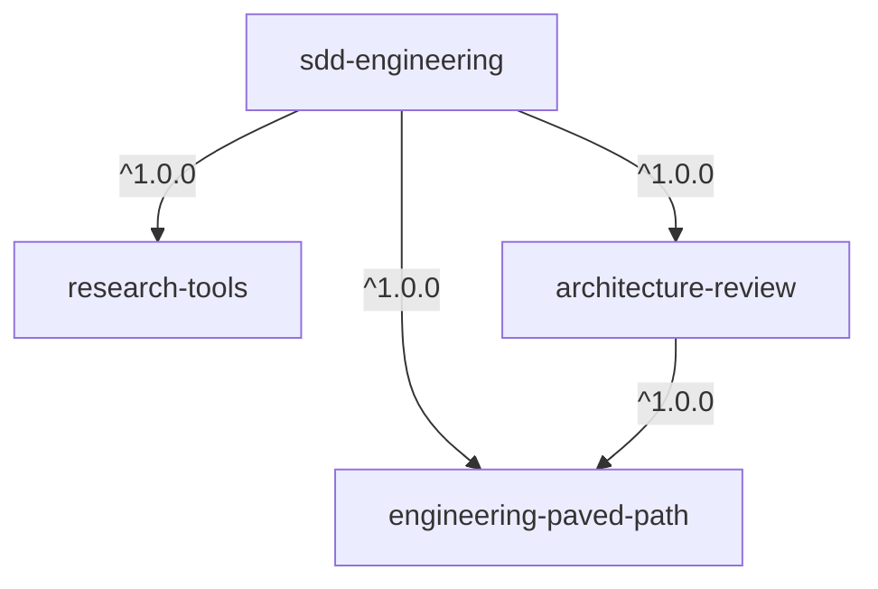

# dev-digest-ai-marketplace

A Claude Code plugin marketplace with the reusable part of the DevDigest harness: a Spec
Driven Development workflow, the agents it delegates to, and the engineering skills they
share. Catalog: https://vklyovsa.github.io/dev-digest-ai-marketplace/

## Plugins

| Plugin | What it gives you | Depends on |
|---|---|---|
| [`sdd-engineering`](plugins/sdd-engineering) | spec-creator → implementation-planner → `/sdd-engineering:run-plan` (implementer, plan-verifier, architecture review) + `/sdd-engineering:workflow-retro`, `engineering-insights` | the three below |
| [`architecture-review`](plugins/architecture-review) | read-only `architecture-reviewer` that checks a diff against the repository's own architecture docs | `engineering-paved-path` |
| [`research-tools`](plugins/research-tools) | read-only `researcher`: one question, answered with evidence from the repo or official sources | — |
| [`engineering-paved-path`](plugins/engineering-paved-path) | shared skills: React, Next.js, testing, Fastify, Drizzle, PostgreSQL, Zod, TypeScript, architecture, security, Mermaid | — |



## Usage

```bash
# once per repository (or --scope user for every repository)
claude plugin marketplace add vklyovsa/dev-digest-ai-marketplace --scope project
claude plugin install sdd-engineering@dev-digest-ai-marketplace --scope project   # dependencies come with it
claude plugin list --json
```

Inside Claude Code the same is `/plugin marketplace add vklyovsa/dev-digest-ai-marketplace`
and `/plugin install sdd-engineering@dev-digest-ai-marketplace`, then `/reload-plugins`.

Updating, auto-update, release channels and rollback: [`docs/RELEASES.md`](docs/RELEASES.md).

## Repository layout

```
.claude-plugin/marketplace.json   catalog: one entry per plugin (name, source, description)
plugins/<name>/                   one plugin each — manifest, agents, skills, hooks, evals, docs
docs/                             PLUGIN-GUIDELINES, SECURITY, RELEASES, SITE-SPEC, COST-BASELINE
scripts/validate.mjs              repository rules CI enforces on top of `claude plugin validate`
scripts/build-index.mjs           builds the catalog index for the site
scripts/release.sh, rollback.sh   release checks and the rollback sequence (print-only)
site/                             catalog site (React + Vite), deployed by .github/workflows/pages.yml
```

## Contributing

[`CONTRIBUTING.md`](CONTRIBUTING.md) — where files go, checks to run, PR checklist.
Security rules: [`docs/SECURITY.md`](docs/SECURITY.md).
