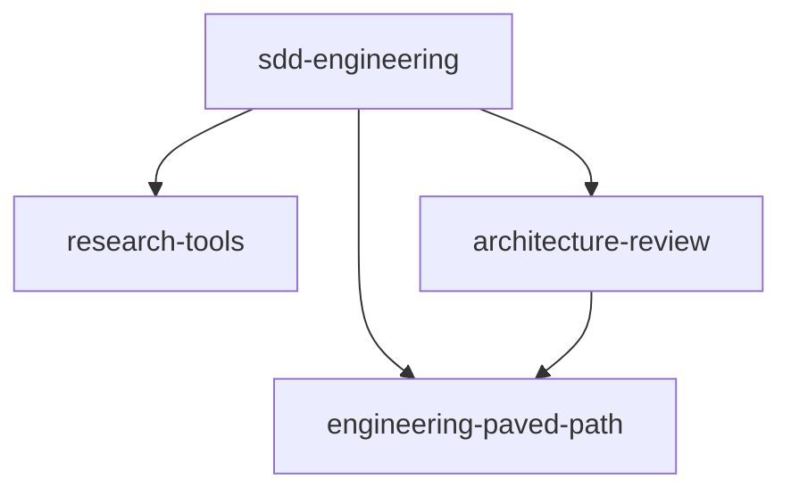

# Plugin guidelines

The standard every plugin in this marketplace is built to. `scripts/validate.mjs` enforces
what can be checked mechanically; review enforces the rest.

## Layout

```
plugins/<name>/
├── .claude-plugin/
│   └── plugin.json          # the source of truth: name, version, dependencies
├── agents/<agent>.md        # optional
├── skills/<skill>/SKILL.md  # optional; supporting files beside it (references/, scripts/, templates/)
├── hooks/hooks.json         # optional; scripts it calls live in hooks/ or scripts/
├── evals/<case>/            # behaviour evals for `claude plugin eval`
├── README.md                # required
├── CHANGELOG.md             # required — Keep a Changelog, one "## [x.y.z] - YYYY-MM-DD" per release
└── COMPATIBILITY.md         # required — minimum Claude Code version, external tools, OS
```

New slash commands go in `skills/` (with `disable-model-invocation: true` when they must only
run on the user's request), not in `commands/`.

## Manifest

```json
{
  "$schema": "https://json.schemastore.org/claude-code-plugin-manifest.json",
  "name": "sdd-engineering",
  "version": "1.0.0",
  "description": "One sentence: what it gives the user.",
  "author": { "name": "AI Engineering" },
  "license": "MIT",
  "keywords": ["sdd"],
  "dependencies": [
    { "name": "engineering-paved-path", "version": "^1.0.0" }
  ]
}
```

- `name` is kebab-case, equals the directory and the marketplace entry, never changes. A
  rename is a new plugin plus a `renames` entry in `marketplace.json`.
- `version` lives in `plugin.json` only — never also in the marketplace entry.
- Components are discovered from the default folders; do not list them in the manifest.
- No credentials in a manifest. A value the user must provide is a `userConfig` entry
  (`sensitive: true` for secrets).

## Dependencies

- A dependency is a plugin of this marketplace, referenced by bare name with a SemVer range:
  `{ "name": "research-tools", "version": "^1.0.0" }`. Claude Code installs dependencies
  automatically and resolves git-backed ones to the highest tag `<name>--v<version>` in range.
- Depend on what you actually call. Calling a dependency's component means writing its
  **namespaced** name: `engineering-paved-path:zod`, `research-tools:researcher`,
  `architecture-review:architecture-reviewer`. `validate.mjs` fails a namespaced reference to
  a plugin you do not depend on, or to a component that plugin does not ship.
- A skill is copied into exactly one plugin. Shared technical skills live in
  `engineering-paved-path`; nothing else carries a copy.
- No cycles. The graph today:



## Portability — the plugin runs in someone else's repository

- **No product paths.** No `server/`, `client/`, `@devdigest/...`, no file a consumer
  repository does not have. A plugin learns the repository from explicit inputs: the user's
  request, `CLAUDE.md` / `AGENTS.md`, and — for `sdd-engineering` — the optional project
  profile `.claude/sdd-profile.md` (see that plugin's README).
- **Plugin files through variables.** Hooks and manifests use `${CLAUDE_PLUGIN_ROOT}`; a script
  inside a skill is called as `${CLAUDE_SKILL_DIR}/scripts/<file>`. `$CLAUDE_PROJECT_DIR` is
  for the consumer's files only.
- **Persistent state** goes to `${CLAUDE_PLUGIN_DATA}` (survives updates) or into the
  consumer repository only where the README documents it (e.g. `specs/`).
- **Do not override project instructions.** A plugin's text yields to the repository's
  `CLAUDE.md` / `AGENTS.md` when they disagree, and says so.
- **Graceful absence.** When a tool, a file or a command the plugin would use is missing
  (no test command, no `INSIGHTS.md`, no `jq`), the plugin reports it and continues or stops
  in a documented way — it never guesses.

## Agents

- Frontmatter: `name`, `description` (when to use it — this is what routing reads), `model`,
  `tools`, `disallowedTools`. Least privilege: a read-only agent has no write tools.
- Not supported in plugin agents and rejected by `validate.mjs`: `hooks`, `mcpServers`,
  `permissionMode`. A guard goes into the plugin's `hooks/hooks.json` and checks the
  `agent_type` field of the hook input (`<plugin>:<agent>`).
- An agent states the rules it needs in its own file or names the skill that holds them; it
  does not depend on the user's personal `~/.claude` settings.
- No duplicated instructions: a rule lives in one skill or reference and agents point to it.

## Skills

- `name` equals the directory. The `description` says what it does and when to use it, in
  under 1 024 characters; discovery reads only this.
- Long material goes to `references/` and is loaded on demand — keep `SKILL.md` short.
- Scripts: `${CLAUDE_SKILL_DIR}/scripts/...`, zero dependencies beyond Node ≥ 22 / POSIX
  shell, and declared in `allowed-tools` as `Bash(node ${CLAUDE_SKILL_DIR}/scripts/x.mjs *)`.

## Evals

- Every behaviour a plugin promises has a case in `evals/<case>/` (`prompt.md` +
  `graders/*.md`), runnable with `claude plugin eval plugins/<name>`.
- At least one **negative** case: an unrelated request must not trigger the plugin.
- Free graders (`regex`, `tool_used`, `tool_order`, `file_exists`) first; an `llm` grader only
  for what a pattern cannot judge.

## Documentation

- English everywhere: docs, prompts, code comments, commit messages.
- `README.md`: what it is, components table, how they work together (diagram), install,
  inputs it reads, files it writes, configuration, dependencies.
- `CHANGELOG.md`: newest first, `Added / Changed / Fixed / Removed / Security`.
- `COMPATIBILITY.md`: `## Requires` (first line is shown on the catalog), tested versions,
  external tools.
