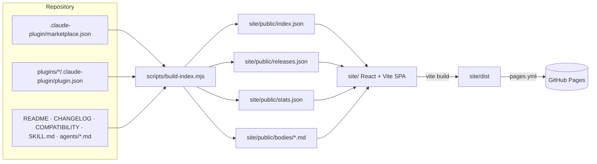

# Catalog site — specification

A static catalog of this marketplace on GitHub Pages. The CLI stays the way to install; the
site is for **discovery**: find a plugin or a skill, read its docs, see its dependencies,
copy the install command.

## Constraints

- **GitHub Pages serves static files only.** No backend, no database, no runtime reads of the
  repository. Everything the browser needs is a build-time snapshot (`site/public/*.json`).
- **Out of scope for v1:** ratings, download counters, accounts, comments, server-side search.
- **Untrusted content.** README / SKILL.md / agent bodies are repository content: rendered with
  `marked`, then always sanitised with `DOMPurify`.
- **Real data only.** The site shows what `plugins/` contains; no mock plugins.
- **English UI.** UI strings live in one file (`site/src/i18n/en.ts`), never inline in components.

## Architecture



- `npm run build:index` (repo root) runs the indexer. `site/` has its own `package.json`;
  `npm run dev` / `npm run build` there run the indexer first (`predev`, `prebuild`).
- Generated JSON and `site/dist/` are git-ignored. CI rebuilds them.
- `pages.yml` builds on every push to `main` and deploys `site/dist`. `validate.yml` builds
  the site on pull requests as a separate `build-site` job so a broken site is visible on its
  own.

## Index format

`index.json`:

```jsonc
{
  "generatedAt": "2026-10-17T10:00:00.000Z",
  "commit": "abc1234",               // GITHUB_SHA or `git rev-parse --short HEAD`, else null
  "marketplace": {
    "name": "dev-digest-ai-marketplace",
    "owner": "AI Engineering",
    "repo": "vklyovsa/dev-digest-ai-marketplace",   // from package.json "repository" or GITHUB_REPOSITORY
    "description": "…"
  },
  "plugins": [
    {
      "name": "sdd-engineering",
      "version": "1.0.0",
      "description": "…",
      "author": "AI Engineering",
      "license": "MIT",
      "keywords": ["sdd", "spec"],
      "category": "workflow",            // marketplace entry "category", else null
      "source": "./plugins/sdd-engineering",
      "dependencies": [{ "name": "engineering-paved-path", "version": "^1.0.0" }],
      "dependents": ["…"],               // computed: plugins that depend on this one
      "compatibility": "Claude Code >= 2.1.110",   // first line under "## Requires" in COMPATIBILITY.md, else null
      "install": "/plugin install sdd-engineering@dev-digest-ai-marketplace",
      "readme": "bodies/plugin--sdd-engineering.md",
      "changelog": "bodies/changelog--sdd-engineering.md",   // or null
      "artifacts": ["sdd-engineering:spec-creator", "…"]     // artifact ids
    }
  ],
  "artifacts": [
    {
      "id": "sdd-engineering:spec-creator",   // <plugin>:<name> — the namespaced name Claude Code uses
      "kind": "agent",                         // agent | skill | command | hook | mcp
      "name": "spec-creator",
      "plugin": "sdd-engineering",
      "description": "…",                      // frontmatter description
      "model": "opus",                         // agents only, else null
      "tools": ["Read", "Grep"],              // agents: tools; skills: allowed-tools; else []
      "manual": false,                         // skills: disable-model-invocation
      "invoke": "/sdd-engineering:run-plan",   // skills/commands: slash form; agents: "@sdd-engineering:spec-creator"
      "path": "plugins/sdd-engineering/agents/spec-creator.md",
      "body": "bodies/agent--sdd-engineering--spec-creator.md",
      "files": ["SKILL.md", "references/…"]    // skills: files inside the skill dir (relative), else []
    }
  ]
}
```

`releases.json` — the release feed, newest first, parsed from each plugin's `CHANGELOG.md`
(`## [1.1.0] - 2026-10-17` headings) and joined with git tags `<plugin>--v<version>` when the
checkout has them:

```jsonc
[{ "plugin": "sdd-engineering", "version": "1.1.0", "date": "2026-10-17",
   "tag": "sdd-engineering--v1.1.0", "tagged": true, "notes": "markdown of the section" }]
```

`stats.json` — counts for the stats tiles: plugins, agents, skills, commands, hooks, total
artifacts, dependency edges, latest release, `generatedAt`.

`bodies/*.md` — full markdown bodies, frontmatter stripped, loaded on demand by detail pages.

## Routes (hash routing)

| Route | Screen |
|---|---|
| `#/` | Home: search box, stats tiles, plugin cards, latest releases |
| `#/search?q=…&kind=…&plugin=…` | Results as cards; facets by kind and plugin; keyboard navigation |
| `#/plugin/<name>` | Plugin: version, owner, compatibility, dependencies + dependents (links), components grouped by kind, install command with Copy, README, changelog |
| `#/artifact/<id>` | Artifact: kind, plugin, description, model/tools, invoke form, files, rendered body; install command of its plugin |
| `#/whats-new` | Release feed from `releases.json` |
| `#/getting-started` | Add the marketplace, install, update, roll back — the commands from `docs/RELEASES.md` |

## Search

- Client-side MiniSearch over plugins and artifacts: fields `name` (boost 3), `description`
  (boost 2), `keywords`, `plugin`, `body` text (README / SKILL.md / agent body, loaded into the
  index at build time as plain text, truncated to 4 000 chars per document).
- Prefix + fuzzy (0.2) matching; results as cards showing kind, namespaced id, description.
- `/` or `Ctrl/Cmd+K` focuses search from anywhere; `↑/↓/Enter` navigate results.

## Copy install

Every plugin card and detail page shows
`/plugin install <name>@dev-digest-ai-marketplace` with a Copy button
(`navigator.clipboard.writeText`, with a visible "Copied" state). Getting started shows
`/plugin marketplace add vklyovsa/dev-digest-ai-marketplace` first.

## Look

Dark-first with a light theme toggle (persisted in `localStorage`), IBM Plex Sans / Mono,
accent colour per artifact kind (plugin blue, skill green, agent violet, command amber, hook
lime, mcp red) — following the Claude Design prototype `Catalog.dc.html` from the L08 course materials (not kept in this repository).

## Acceptance

- Every plugin and every nested skill / agent is found by searching its name.
- Version and dependencies on a plugin page equal its `plugin.json`.
- Copy install puts the exact command on the clipboard.
- A `<script>` inside a README is not executed (DOMPurify).
- `npm ci && npm run build` in `site/` succeeds on a clean checkout.
