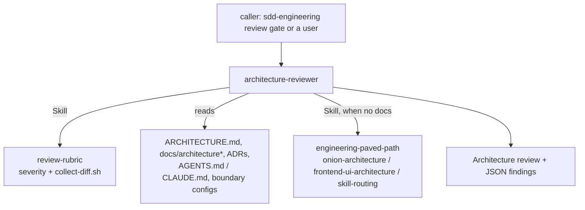

# architecture-review

A read-only `architecture-reviewer` agent that checks a diff against **the repository's
own architecture rules** — dependency direction between layers, module boundaries, where
frontend code is placed, contracts that exist in more than one copy — and reports each
violation as a named rule at a real `file:line`, with a fixed severity rubric. It never
edits; a plugin hook enforces that.

## Components

| Component | Type | Role |
|---|---|---|
| `architecture-reviewer` | agent (`model: sonnet`) | the review; tools `Read, Grep, Glob, Bash, Skill`; write tools, `Agent` and web tools disallowed |
| `review-rubric` | skill (not user-invocable) | severity rubric, finding contract, recheck protocol (`references/severity.md`) and `scripts/collect-diff.sh` |
| `hooks/hooks.json` → `hooks/readonly-guard.mjs` | PreToolUse hook | allowlist guard for this agent only |
| `hooks/guard-cases.tsv` + `scripts/check-guard.mjs` | test table + runner | every guard decision as input → expected exit code |



## What it reads

1. The diff: `collect-diff.sh` (branch since merge base + uncommitted + untracked), a
   base ref you name, or a diff pasted inline.
2. The repository's rules: `ARCHITECTURE.md`, `docs/architecture*`, `docs/adr/**`, the
   layering sections of `AGENTS.md` / `CLAUDE.md` (root and touched packages),
   `.dependency-cruiser.*`, ESLint boundary rules (`eslint-plugin-boundaries`,
   `import/no-restricted-paths`, `no-restricted-imports`), `.importlinter`, and the
   knowledge files the instructions name (e.g. `INSIGHTS.md`).
3. Optionally a plan (its impact map and reviewer handoff note) or an implementation report.

## What it checks

- **Deterministic:** the repository's dependency-cruiser config (when the tool is
  installed: `npx --no-install depcruise`), ESLint boundary rules, the typecheck of touched
  packages; otherwise targeted greps for each forbidden edge. Plus property access on the
  DI container from routes, one-sided changes to duplicated contracts, and fetches outside
  the documented data-access path.
- **Judgement:** wrong layer for a new file, a route doing more than calling a service, row
  types in public service signatures, a constructor taking the container, frontend code
  placed by type, cross-feature imports, `'use client'` on a route root — each only when a
  stated rule covers it.

Not checked: security, style, test coverage, taste.

## Fallback

When the repository documents no architecture for an area the diff touches, the reviewer
loads `engineering-paved-path:onion-architecture` (backend) or
`engineering-paved-path:frontend-ui-architecture` (frontend) with the Skill tool, maps its
default layers onto the repository's folders with the rulebook's `mapping.md`, and says
so under **Rules source** in the report. `engineering-paved-path:skill-routing` decides
which rulebook governs a file when that is unclear.

## Output contract

A Markdown report — Rules source, Checks run, Findings, Handoff surfaces checked, Not
checked — ending with a fenced `json` array. Every finding carries the fields

```
severity · band · file · line · in_diff · skill · rule_source · title · evidence · failure · fix · verified
```

Severity is `CRITICAL` / `WARNING` / `SUGGESTION`; CRITICAL requires a location inside the
diff, a concrete failure scenario and verification by opening the file. `band` is always
`n/a`. At most 10 findings, CRITICAL first.

**Recheck:** after a fix round, send the fixed finding IDs and touched files to the same
agent; it answers `resolved` / `still open` / `changed` per finding, reruns the matching
checks and returns the JSON of what is still open.

## How sdd-engineering uses it

The sdd-engineering plugin depends on this one and calls the agent as
`architecture-review:architecture-reviewer` in its review gate, after the plan verifier
finds the plan implemented and alongside the security and test reviews. Its run-plan
orchestrator parses the finding contract and the JSON block, sends CRITICAL / WARNING
findings back to the implementer, and resends the fixed IDs to the same reviewer instance
for the recheck. Keep the field names and the recheck vocabulary stable — they are an
interface.

It works the same outside that workflow: ask Claude to "review the architecture of this
branch" or delegate to `architecture-review:architecture-reviewer` with a base ref.

## The read-only guard

`hooks/readonly-guard.mjs` runs before every `Bash`, `Write`, `Edit`, `MultiEdit` and
`NotebookEdit` call and acts **only** when `agent_type` is exactly
`architecture-review:architecture-reviewer`; everything else passes untouched. For the
reviewer it blocks the write tools and allows a `Bash` command only when every segment
(including `$( … )`, `bash -c`, `xargs`) is on the allowlist:

- read-only git;
- `ls cat head tail wc grep rg find sort uniq cut tr diff cmp comm jq stat file echo
  printf test cd pwd …` without writing flags (`find -delete/-exec`, `sort -o`, `rg --pre`);
- `sed -n` with a print-only script;
- the plugin's own `collect-diff.sh` (matched by real path under `${CLAUDE_PLUGIN_ROOT}`);
- `depcruise` (no `--output-to`, `--init`, `--cache`), `tsc --noEmit` (no `--build`,
  `--incremental`), `eslint` (no `--fix`, `--output-file`, `--cache`) — through
  `npx --no-install`, `pnpm exec`, `npm exec --no` or `node_modules/.bin`;
- `npm` / `pnpm` / `yarn` scripts named `typecheck`, `lint`, `lint:*`, `arch:check` and
  similar, never `*fix*` / `*format*`.

Redirects into files, installs, test runners, interpreters, `sudo`, `eval` and unknown
commands are refused. Note that a repository's own `lint` or `typecheck` script runs as
the repository defines it. The guard fails closed (exit 2) on input it cannot parse.

```bash
node plugins/architecture-review/scripts/check-guard.mjs
```

## Install

```text
/plugin marketplace add vklyovsa/dev-digest-ai-marketplace
/plugin install architecture-review@dev-digest-ai-marketplace
```

`engineering-paved-path` is installed with it as a dependency.

## Inputs, outputs, configuration

- Writes: nothing. The report is the agent's reply.
- Network: none (web tools are disallowed; the guard and `collect-diff.sh` stay local).
- Configuration: none. The repository's own docs and `CLAUDE.md` / `AGENTS.md` override
  the fallback rulebooks.
- Dependencies: `engineering-paved-path` `^1.0.0`. Node.js >= 22 for the guard and the
  diff script (see `COMPATIBILITY.md`).
