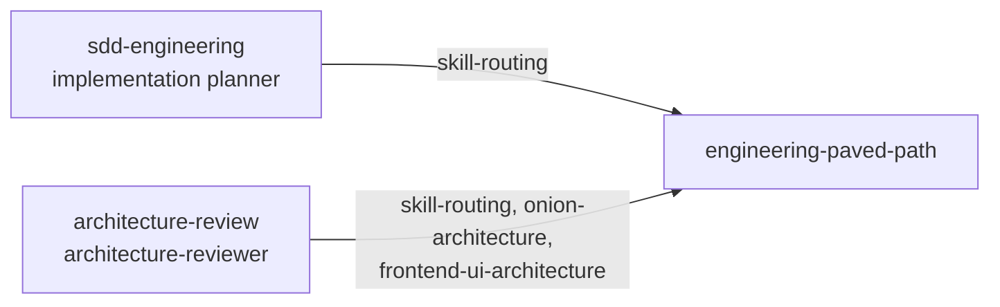

# engineering-paved-path

Shared engineering skills for TypeScript web stacks — the "paved path" the other plugins
of this marketplace build on. Each skill is a rulebook Claude loads on demand when the
work matches its description; nothing here runs on its own.

The list is deliberately limited to the skills the `sdd-engineering` workflow (planning,
implementing, reviewing) and the `architecture-review` reviewer actually use. It is not a
general skill catalogue.

## Skills

| Skill | What it covers | Triggers when |
|---|---|---|
| `react-best-practices` | component design, state, hooks misuse, performance, data fetching; severity-tagged anti-patterns | writing, reviewing or refactoring React components and hooks |
| `react-testing-library` | RTL + Vitest: setup, query priority, `userEvent`, async, MSW mocking, user-flow tests | writing or reviewing component / hook tests |
| `next-best-practices` | App Router file conventions, RSC boundaries, data patterns, metadata, route handlers, images, fonts, bundling | writing or reviewing Next.js code (background knowledge, not user-invocable) |
| `fastify-best-practices` | routes, plugins, JSON Schema validation, hooks, errors, logging, auth, CORS, testing, deployment | building or debugging a Fastify server |
| `frontend-ui-architecture` | where frontend code belongs, import direction, colocation and promotion, barrels, App Router structure | placing a new component / hook / util, splitting a file, reviewing structure |
| `onion-architecture` | dependency rule, layer map, routes as driving adapters, repositories as driven adapters, ports instead of the container, OA-1…OA-13 checklist, dependency-cruiser enforcement | adding or reviewing backend modules, routes, services, repositories, adapters, DI wiring |
| `drizzle-orm-patterns` | schemas, CRUD, relations, joins, transactions, migrations with Drizzle Kit | any Drizzle ORM work |
| `postgresql-table-design` | keys, data types, constraints, indexing, partitioning, PostgreSQL-specific features | designing or reviewing a PostgreSQL schema |
| `zod` | schema design, parsing, `safeParse`, refinements, composition, error handling, performance | defining or reviewing Zod schemas |
| `typescript-expert` | type-level programming, strictness, performance, monorepo and migration tooling | advanced TypeScript questions and type errors |
| `security` | OWASP Top 10:2025 with confidence-based review, auth, input handling, secrets, uploads | reviewing code for vulnerabilities, building auth or API endpoints |
| `mermaid-diagram` | flowcharts, sequence, class, ER, state diagrams in Markdown | visualising a workflow, architecture or data model |
| `skill-routing` | file-pattern → skill table (path and content triggers) | a planner or reviewer must decide which skills govern a set of files (not user-invocable) |

`onion-architecture` and `frontend-ui-architecture` each carry a `mapping.md`: how to map
their layers and placement rules onto a repository by reading its own `ARCHITECTURE.md`,
`docs/architecture*.md`, ADRs, `AGENTS.md` / `CLAUDE.md` and boundary-linter configs. The
repository's documented rules always win over the skill's defaults.

## How the plugins use them



Other plugins reference these skills by their **namespaced** name and load them with the
Skill tool, for example `engineering-paved-path:zod` or
`engineering-paved-path:onion-architecture`, and declare the dependency in their
`plugin.json`:

```json
"dependencies": [{ "name": "engineering-paved-path", "version": "^1.0.0" }]
```

`skill-routing` is the table those plugins consult to pick skills per file. A repository
can replace it with its own routing file through the `skill_routing` key of the
sdd-engineering project profile (`.claude/sdd-profile.md`).

## Install

```text
/plugin marketplace add vklyovsa/dev-digest-ai-marketplace
/plugin install engineering-paved-path@dev-digest-ai-marketplace
```

## Inputs and outputs

- Reads: only what the task points at, plus the repository's architecture docs when an
  architecture skill maps itself onto the repository.
- Writes: nothing. No hooks, no scripts, no persistent state.
- Configuration: none.
- Dependencies: none.

## Third-party sources

The components were extracted from DevDigest; the six skills below originate upstream, the rest were authored there.

| Skill | Upstream |
|---|---|
| `drizzle-orm-patterns` | [giuseppe-trisciuoglio/developer-kit](https://github.com/giuseppe-trisciuoglio/developer-kit) |
| `fastify-best-practices` | [mcollina/skills](https://github.com/mcollina/skills) |
| `next-best-practices` | [vercel-labs/next-skills](https://github.com/vercel-labs/next-skills) |
| `postgresql-table-design` | [wshobson/agents](https://github.com/wshobson/agents) |
| `typescript-expert` | [sickn33/antigravity-awesome-skills](https://github.com/sickn33/antigravity-awesome-skills) |
| `zod` | [pproenca/dot-skills](https://github.com/pproenca/dot-skills) |

Authored in-house: `react-best-practices`, `react-testing-library` (a rewrite of an earlier
community skill; sources in its `README.md`), `frontend-ui-architecture` (sources in its
`README.md`), `onion-architecture` (sources in `references.md`), `security` (draws on the
community security skills listed in its `references.md`), `mermaid-diagram`, and
`skill-routing`.

Upstream skills keep their original licences; check the upstream repository before
redistributing a modified copy.
