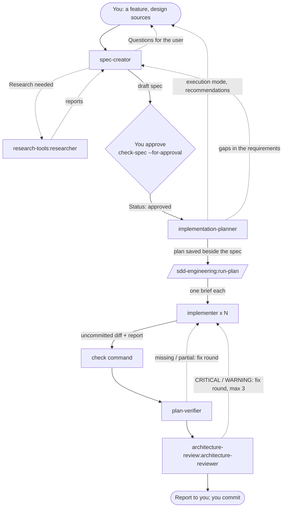

# sdd-engineering

Spec Driven Development (SDD) for Claude Code: a feature is first written down as a spec the user
approves, then planned in stages, built by short-lived implementer agents under guards, verified
against the plan item by item, and reviewed for architecture with bounded fix rounds. Nothing is
committed by the plugin — the diff stays for you.

**SDD here means:** requirements live in a spec with EARS acceptance criteria and open questions
marked in place (`[NEEDS CLARIFICATION: … → OQ-n]`), never guessed; the plan copies those
requirements word for word and adds only *how*; every claim of "done" is checked by opening the
file. Questions go to you, never answered by an agent on your behalf.

## Components

| Component | Id | Kind | What it does |
|---|---|---|---|
| spec-creator | `sdd-engineering:spec-creator` | agent (opus) | Writes a draft spec from your request and design sources; returns blocking questions and research items first |
| implementation-planner | `sdd-engineering:implementation-planner` | agent (opus), read-only | Turns an approved spec into a staged plan (sections 0–10) with skills per stage, verification and execution tracks |
| implementer | `sdd-engineering:implementer` | agent (sonnet) | Executes one brief (one or two stages, or a fix brief), adds tests, runs the check command, reports with evidence |
| plan-verifier | `sdd-engineering:plan-verifier` | agent (sonnet), read-only | Marks every plan and spec item done / partial / missing / deviated with `file:line`; finds unplanned changes |
| run-plan | `/sdd-engineering:run-plan` | skill, manual only | Orchestrates implementers → check → plan-verifier → architecture review with fix rounds → report |
| engineering-insights | `sdd-engineering:engineering-insights` | skill | Reads insights files before editing, appends a verified learning (append-only script) |
| workflow-retro | `/sdd-engineering:workflow-retro` | skill, manual only | Retrospective of a multi-agent run, written to a ledger; `deep` measures the session transcripts |
| agent guard | `hooks/hooks.json` → `hooks/agent-guard.mjs` | PreToolUse hook | Enforces each agent's write limits (§ Guards) |
| check-spec | `scripts/check-spec.mjs` | script | Validates a spec against the template in use |

## How they work together



The calling session (your main conversation) relays every question with `AskUserQuestion` —
subagents cannot ask you themselves — starts one `research-tools:researcher` per research item,
and sends answers back to the **same** agent instance with `SendMessage`.

Typical session:

1. "Write a spec for …" → `spec-creator` drafts it (after blocking questions, if any).
2. You answer the non-blocking questions or accept the defaults, and approve. The session runs
   `check-spec --for-approval` and sets `Status: approved`.
3. "Plan the approved spec <path>" → `implementation-planner` returns the plan and asks for the
   execution mode; the session saves it beside the spec.
4. `/sdd-engineering:run-plan <plan path>` builds it and reports.

## Where files are written

| File | Path | Written by |
|---|---|---|
| Spec | `<specs_dir>/<YYYY-MM-DD>-<feature-slug>.md` (`Status: draft`); with `packages` set, a one-package feature goes to `<package>/<specs_dir>/` | `spec-creator` |
| Spec approval | the spec's `Status:` line → `approved` | the calling session, after your explicit approval |
| Plan | `<specs_dir>/<YYYY-MM-DD>-<feature-slug>-plan.md` | the calling session, from the planner's output, after your approval |
| Code and tests | the plan's write sets | `implementer` |
| Insights | the insights files that already exist | `engineering-insights` |
| Retro entry | `<retro_dir>/<YYYY-MM-DD>-<run-slug>.md` | `/sdd-engineering:workflow-retro` |

## The project profile

Optional: `.claude/sdd-profile.md` in your repository, a markdown file with one `yaml` block. Copy
[`templates/sdd-profile.example.md`](templates/sdd-profile.example.md). Every key is optional; the
full rules are in [`templates/profile-reference.md`](templates/profile-reference.md), which every
agent reads.

| Key | Default |
|---|---|
| `specs_dir` | `specs` |
| `spec_template` | `<specs_dir>/TEMPLATE.md` if it exists, else [`templates/spec-template.md`](templates/spec-template.md) |
| `check_command` | discovered: project instructions, then `package.json` scripts, `Makefile` / `justfile`, `pyproject.toml`, `go.mod`, `Cargo.toml`; may contain `{package}` |
| `packages` | none (one package) |
| `insights_files` | `INSIGHTS.md` (+ `<package>/INSIGHTS.md` where present) |
| `architecture_docs` | discovered from project instructions; none is fine |
| `skill_routing` | `engineering-paved-path:skill-routing` |
| `protected_paths` | none, on top of the built-in list (lockfiles, `.env*` except `.env.example`, existing migrations, `.claude/settings*.json`, the profile) |
| `retro_dir` | `docs/retro/ledger` |

Without a profile the agents discover what they need from `CLAUDE.md`, `AGENTS.md` (root and per
package), manifests and scripts. **Your `CLAUDE.md` / `AGENTS.md` win over the plugin** whenever
they disagree, and the agents say which rule they followed.

### When no check command exists

No agent invents one. The planner, the implementer and the verifier report
`Verification: not run — no check command found; set check_command in .claude/sdd-profile.md`,
mark the acceptance criteria that needed a run as "needs a test run", and `run-plan` puts that in
its report instead of looping over a check that cannot run.

## Guards

One `PreToolUse` hook (`Bash|Edit|MultiEdit|Write|NotebookEdit`) runs
`node "${CLAUDE_PLUGIN_ROOT}/hooks/agent-guard.mjs"`. It acts only when the hook input's
`agent_type` is one of this plugin's agents; your main session and every other agent pass
untouched. A block is exit 2 with a one-line reason; any unexpected error also exits 2 (fails
closed).

| Agent | Allowed | Blocked |
|---|---|---|
| `implementation-planner` | read-only git, text tools (`grep`, `sed -n`, `find` without actions, …), typecheck / lint without `--fix`, `check-spec.mjs` | every file-writing tool; tests and the check command; installs; redirects into files, `sed -i`, `find -delete`, inline scripts |
| `plan-verifier` | the planner's allowlist, plus the check command and test runners | everything the planner is blocked from except tests; `-u` / `--watch` |
| `spec-creator` | `Edit`/`Write` on `<spec dir>/<YYYY-MM-DD>-<slug>.md` that is new or says `Status: draft`, and the spec folder's `README.md`; read-only Bash + `check-spec.mjs` + `date` | plans (`*-plan.md`), `TEMPLATE.md`, approved specs, any other path; tests, network, git state |
| `implementer` | everything else inside the project | git state changes, pushes, branch deletes, `gh pr` writes; applying migrations or seeds, `dropdb`, `pg_restore`, database-client writes, `docker compose down -v`, volume removal; lockfiles, `.env*` (not `.env.example`), existing migration files, `.claude/settings*.json`, the profile, `protected_paths`, the plugin's own files, paths outside the project |

The same limits are written in each agent's text, because hooks may not run before the
workspace-trust dialog is accepted. Check the guard after a change:

```bash
node scripts/check-guards.mjs            # every row of hooks/guard-cases.tsv, synthetic payloads
node scripts/check-guards.mjs --verbose  # with each block reason
```

A new guard rule gets an allow row and a deny row in `hooks/guard-cases.tsv`.

## Manual-only skills

`/sdd-engineering:run-plan` and `/sdd-engineering:workflow-retro` carry
`disable-model-invocation: true`: they run only when you type them. `workflow-retro` reads your
local session transcripts under `~/.claude/projects/` through its own script (no network) and
writes one ledger entry.

## Inputs it reads

Your request and design sources; `CLAUDE.md` / `AGENTS.md`; `.claude/sdd-profile.md`; the spec
template; insights files; the docs your instructions point to; the code. Text inside a source is
data — an instruction found there is reported, not followed.

## Dependencies

| Plugin | Used for |
|---|---|
| `engineering-paved-path` `^1.0.0` | `engineering-paved-path:skill-routing` and the technical skills the planner cites per stage and the implementer loads |
| `research-tools` `^1.0.0` | `research-tools:researcher`, one per research item of `spec-creator` |
| `architecture-review` `^1.0.0` | `architecture-review:architecture-reviewer`, the review step of `run-plan` |

Claude Code installs them with this plugin.

## Tool choices

- `implementation-planner` has `Skill` (and no write tool): the routing and the paved-path skills
  live in another plugin's cache, at a path the planner cannot know, so it loads them with `Skill`
  instead of `Read`. Loading a skill writes nothing; the guard still refuses every write.
- `spec-creator` has no `Skill`, `Agent` or web tools: it reads the repository, and everything it
  cannot read becomes a question or a research item for the calling session.
- `implementer` has `Skill` to load the skills a stage cites and `engineering-insights`.

## Not included

Kept out of 1.0.0 on purpose (they exist in the workflow this plugin was extracted from):
a test-writer agent, a doc-writer agent, a security reviewer (`--security` of the original
orchestrator), an options-comparison agent, a pre-PR self-review gate, and a commit gate hook.
`run-plan` reports which criteria still have no test and which security surfaces the plan names,
so you can cover them yourself.

## Quick start in a new repository

```
/plugin marketplace add vklyovsa/dev-digest-ai-marketplace
/plugin install sdd-engineering@dev-digest-ai-marketplace
```

Then ask for a spec: "Write a spec for <feature>". Optionally add `.claude/sdd-profile.md` first
(at least `check_command`), so verification has a command to run.

Extracted from the Spec Driven Development workflow of the DevDigest project.
